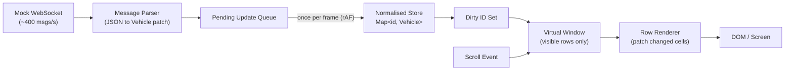

# ADR-0001: State Management and Virtualisation Strategy for 400 Concurrent Vehicles

- **Status:** Accepted
- **Date:** 2026-11-14
- **Deciders:** Hashim Anwar
- **Scope:** Live dispatch table (400 vehicles, mock WebSocket updates)

> Note: figures marked **(est.)** are design estimates from reasoning about the DOM and typical library sizes. They must be confirmed with the Chrome Performance panel and `vite build` output (see [Validation Plan](#8-validation-plan)).

---

## 1. Context

The dispatch console shows **400 vehicles live** in a table. Each vehicle has ~12 columns (ID, driver, status, speed, lat, lng, fuel, ETA, etc.). A mock WebSocket pushes position/status updates, assumed at **~1 update per vehicle per second, ≈ 400 messages/second** in the worst case.

Constraints:
- Vanilla JS + Vite (no heavy framework assumed).
- Must stay smooth on a mid-range laptop and mobile.
- Keep the bundle small (the project is graded on speed and accessibility).

## 2. Core Performance Bottlenecks of Rendering 400 Live Rows

| # | Bottleneck | Why it hurts |
|---|-----------|--------------|
| 1 | **DOM size** | 400 rows × 12 cells ≈ 4,800 cells + wrappers ≈ **5,000–6,000 nodes (est.)**. Large DOM slows style recalculation, layout and memory. |
| 2 | **Update frequency** | 400 msgs/s means up to 400 DOM writes/s. Writing per message causes layout thrash. |
| 3 | **Full re-render** | Re-rendering the whole table on each message repeats the work for 399 unchanged rows. |
| 4 | **Main-thread blocking** | JSON parsing + rendering in the same frame drops frames below 60 fps (16.6 ms budget). |
| 5 | **Memory churn** | Creating new row objects/strings on every message triggers frequent garbage collection pauses. |
| 6 | **Accessibility cost** | Thousands of focusable/announced nodes make screen-reader navigation slow. |

## 3. Decision Drivers

1. Frame time under 16 ms during live updates.
2. Small bundle size (no large dependency for one table).
3. Low memory footprint.
4. Full control over accessibility (ARIA roles, keyboard navigation).
5. Simple data flow that is easy to explain and test.

## 4. Options Considered

### Option A: Render all 400 rows (naive)
- **Rendering:** ~5,000+ DOM nodes always mounted. Each tick repaints large areas.
- **Bundle:** 0 KB extra.
- **Memory:** highest DOM memory (est. 2–4× the virtualised version).
- **Verdict:** ❌ **Rejected.** Fails on frame time once updates arrive at 400/s.

### Option B: AG Grid Community (heavy UI library)
- **Rendering:** excellent, built-in virtualisation.
- **Bundle:** roughly **250–300 KB gzipped (approx.)**, about 100× larger than our custom code.
- **Memory:** good, but library overhead and internal models add to the heap.
- **Cost:** large API surface, theming overrides, harder to guarantee accessibility tweaks.
- **Verdict:** ❌ **Rejected.** Bundle cost is disproportionate for a single table with fixed columns.

### Option C: MUI X DataGrid / similar component-suite grid
- **Rendering:** good virtualisation.
- **Bundle:** roughly **100–150 KB gzipped plus its core/styling runtime (approx.)**, and it requires React.
- **Cost:** forces a framework change on a vanilla JS project.
- **Verdict:** ❌ **Rejected.** Framework lock-in plus bundle size.

### Option D: Small virtual-list library (e.g. TanStack Virtual / react-window)
- **Rendering:** excellent, only visible rows mounted.
- **Bundle:** roughly **3–6 KB gzipped (approx.)**.
- **Cost:** still a dependency; the headless variant needs custom markup anyway, and the others assume React.
- **Verdict:** ⚠️ **Close second.** Viable fallback if the custom version fails the budget.

### Option E (CHOSEN): Custom virtualisation + normalised store + batched updates
- **Rendering:** only visible rows + overscan mounted, about **20–25 rows × 12 cells ≈ 300 nodes (est.)**, a **~95% DOM reduction** versus Option A.
- **Bundle:** **~2 KB of own code, 0 KB dependencies (est.)**.
- **Memory:** one plain `Map<vehicleId, Vehicle>` in memory (400 small objects, tens of KB).
- **Cost:** we own the scroll maths and the accessibility handling.
- **Verdict:** ✅ **Chosen.**

### Summary of Trade-offs

| Option | DOM nodes mounted | Extra bundle (gz) | Dependency | Frame-time risk |
|---|---|---|---|---|
| A. Render all | ~5,000–6,000 | 0 KB | none | High |
| B. AG Grid | ~300 | ~250–300 KB | heavy | Low |
| C. MUI DataGrid | ~300 | ~100–150 KB+ | React + MUI | Low |
| D. Virtual-list lib | ~300 | ~3–6 KB | small | Low |
| **E. Custom (chosen)** | **~300** | **~2 KB** | **none** | **Low** |

## 5. Decision

We will implement:

1. **Normalised store:** a single `Map<vehicleId, Vehicle>` as the source of truth. Updates mutate/replace one entry, never the whole array.
2. **Update batching:** incoming WebSocket messages are pushed into a **pending queue**; a single `requestAnimationFrame` flush applies them once per frame (max 60 flushes/s instead of 400).
3. **Dirty-row tracking:** the flush records which vehicle IDs changed; only those rows, if currently visible, are patched.
4. **Custom windowing:** a scroll container with a spacer of height `rowCount × rowHeight`. Only rows in `[startIndex, endIndex]` (visible + overscan of 5) exist in the DOM. Fixed row height keeps the maths O(1).
5. **Row recycling:** DOM row elements are reused and re-bound to new data while scrolling, instead of created/destroyed.
6. **Cell-level patching:** only text nodes whose value changed are updated (`if (el.textContent !== next) el.textContent = next`).

## 6. Data Flow: Mock WebSocket to UI Layers

**Layer responsibilities**

| Layer | Responsibility | Must NOT do |
|---|---|---|
| Transport (mock WS) | Emit messages | Touch the DOM |
| Parser | Validate and convert messages to patches | Render |
| Queue | Buffer between frames | Block the main thread |
| Store | Hold the latest state per vehicle | Know about rows or scrolling |
| Virtual window | Decide which indices are visible | Own the data |
| Row renderer | Patch changed cells in visible rows | Re-render unchanged rows |

## 7. Consequences

**Positive**
- Constant render cost regardless of fleet size (scales past 400).
- Tiny bundle, no third-party risk.
- Clear separation of concerns, which makes each layer unit-testable.

**Negative / Risks**
- We maintain scroll and windowing code ourselves (edge cases: fast scroll, resize, variable row height).
- Browser find-in-page (Ctrl+F) only sees mounted rows. Mitigation: add an in-app search/filter.
- Accessibility must be handled manually: `role="grid"`, `aria-rowcount`, `aria-rowindex` on each rendered row, and keyboard navigation.

**Revisit this decision if**
- The fleet grows beyond ~5,000 vehicles, or
- Variable row heights, grouping or column pinning become requirements, or
- Measured frame time exceeds 16 ms at 400 msgs/s (then adopt Option D).

## 8. Validation Plan

1. Record a 10 s Chrome Performance trace with the mock WebSocket at 400 msgs/s; target **median frame ≤ 16 ms**.
2. Count DOM nodes in the table (DevTools console: `document.querySelectorAll('.row *').length`); target **< 500**.
3. Compare the heap in the Memory tab before and after 60 s of updates; confirm no steady growth.
4. Run `vite build` and record the JS size gzipped; replace the **(est.)** values above with the measured numbers.
5. Run Lighthouse accessibility; target **≥ 90**.

## 9. References

- Chrome DevTools Performance panel documentation
- WAI-ARIA Authoring Practices: Grid pattern
- Michael Nygard, *Documenting Architecture Decisions* (ADR format)
